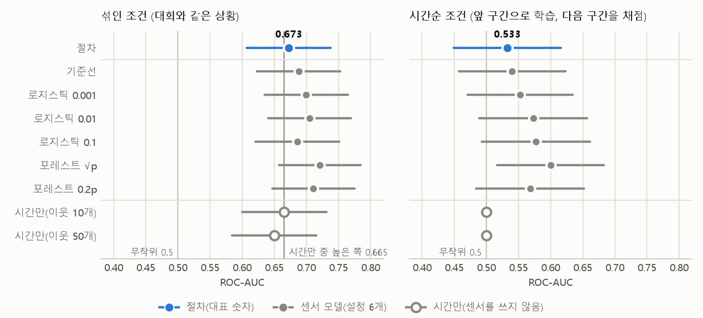
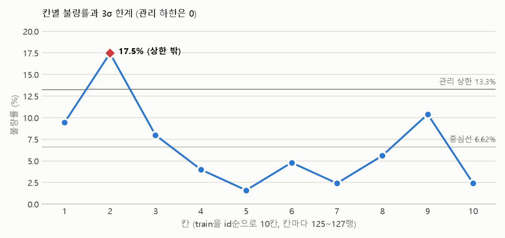
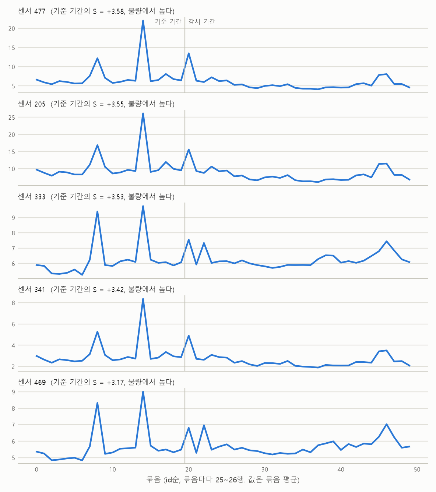

# RESULTS — 결과

> 이 파일은 `python run_all.py --stage report`가 결과 파일(`frozen.json`, `outputs/*.json`)에서 만든다. 손으로 고치지 않는다.
> 평가 절차와 채택 기준은 실제 라벨로 모델을 맞추기 전에 고정했다(`PROTOCOL.md`, 태그 `prereg`). 그 뒤에 바꾼 것은 이 문서 맨 아래에 그대로 옮겨 두었다.
> 데이터: Kaggle 커뮤니티 대회 "SECOM Defect Detection Challenge"의 train 1,253행(불량 83건, 6.62%), 측정 열 590개.
> 이 문서에서 "센서"는 590개 측정 열을 줄여 부르는 말이고, "불량"은 라인 내 검사 불합격이다.

## 1. 요약

- **대표 숫자**: 섞인 조건에서 절차의 ROC-AUC는 **0.673**이다 (공식 구간 0.607 ~ 0.738. 학습 데이터가 달라지는 몫까지 치면 ±0.08로 읽는다: 0.593 ~ 0.753).
- 센서를 하나도 쓰지 않은 **"시간만" 점수**는 같은 폴드에서 0.665(이웃 10개), 0.650(이웃 50개)이다. "그 무렵 불량이 많았는가"만 본 점수다.
- (절차 − 시간만 중 높은 쪽)은 +0.007이고 95% 구간은 −0.104 ~ +0.118이다. 구간이 0을 포함한다. **섞인 조건에서 센서가 시기 정보 이상을 주는지 이 데이터로는 구분하지 못했다.**
- **시간순 조건**(앞 구간으로 학습해 다음 구간을 채점)에서 절차의 AUC는 0.533이다. ±0.10으로 읽으면 0.433 ~ 0.633이다. 0.5를 포함한다. **앞 기간으로 만든 기준이 다음 기간에도 통했다고 말할 수 없다.**
- 전체 데이터에 채택 기준을 적용한 결과: **기준선 유지**. 차이가 가장 큰 후보는 랜덤 포레스트(분기마다 센서 √p개)다. 기준선과의 차이는 +0.026, 채택에 필요한 차이는 0.068이다. 불량 83건으로는 후보와 기준선을 구분하지 못했다.
- (절차 − 기준선)은 −0.015이고 95% 구간은 −0.062 ~ +0.032이다. 고르는 절차가 기준선보다 낫다고 할 수 없다.
- **오경보를 얼마나 허용하면 불량을 얼마나 잡는가**(목표 오경보율 10%): 실제 오경보율 10.3%에서 불량 83건 중 23.0건(27.7%, 구간 19.2% ~ 38.2%)을 잡았다. 100개가 지나갈 때 경보 11.4개, 그중 실제 불량 1.8개, 헛경보 9.6개, 놓친 불량 4.8개다. 같은 수만큼 무작위로 경보를 울리면 검출률은 11.4%다.
- 같은 시기의 양품과 견줘 불량과 함께 움직이는 센서를 찾고 다시 뽑아 봤다(7.2절): **안정적인 센서 0개**(뽑힌 비율 0.8 이상이고 비교 기준 0.87보다 높은 것). 구간을 나누지 않고 고른 상위 20개 가운데 13개는 같은 시기끼리 견주면 20위 밖이었다.
- 기준 기간으로 한계를 정한 센서 관리도 5개(7.3절)에서 감시 기간의 불량 행과 양품 행의 이탈률은 1개에서 미리 정한 규칙상 구분되었다. 서로 닮은 센서 5개를 본 결과라 경계에 걸친 결과로 읽는다(7.3절).
- **Kaggle 공개 리더보드**(test의 약 절반, 불량은 약 10건으로 추정): 이 프로젝트의 결과로 적는 제출 1(기준선)의 점수 0.741. 두 제출 모두 올리기 전에 적어 둔 예상 범위 안이다(9절).
- 8.3절의 경보: 울리지 않았다.

그림: 점은 AUC, 가로선은 공식 구간이다. 왼쪽 그림의 세로선 두 개는 무작위(0.5)와 "시간만" 중 높은 쪽이다. "시간만"은 시간순 조건에서 정의상 0.5다.

## 2. 사전 등록한 표

모든 행을 같은 바깥 15폴드(5등분 × 3반복)에서 채점했다. **이 표의 숫자는 모델을 고르는 데 쓰이지 않았다.** 절차의 점수는 폴드마다 나머지 80% 안에서만 고른 설정을, 고르는 데 쓰지 않은 20%로 채점한 것이다.

| 행 | 섞인 조건 AUC (공식 구간) | 기준선과의 차이 (95% 구간) | 같은 시기 안 AUC (5구간 / 10칸) | 시간순 조건 AUC (공식 구간) |
|---|---|---|---|---|
| 시간만(이웃 10개, 센서를 쓰지 않음) | 0.665 (0.600 ~ 0.731) | −0.023 (−0.165 ~ +0.120) | 0.634 / 0.608 | 0.500 (정의상) |
| 시간만(이웃 50개, 센서를 쓰지 않음) | 0.650 (0.584 ~ 0.716) | −0.038 (−0.149 ~ +0.073) | 0.560 / 0.516 | 0.500 (정의상) |
| 기준선(상위 40개 센서 + 로지스틱 회귀) | 0.688 (0.623 ~ 0.753) |  | 0.644 / 0.636 | 0.540 (0.457 ~ 0.623) |
| 전체 로지스틱(C = 0.001) | 0.700 (0.635 ~ 0.764) | +0.012 (−0.059 ~ +0.082) | 0.668 / 0.659 | 0.553 (0.471 ~ 0.635) |
| 전체 로지스틱(C = 0.01) | 0.705 (0.640 ~ 0.769) | +0.017 (−0.068 ~ +0.101) | 0.676 / 0.671 | 0.573 (0.489 ~ 0.657) |
| 전체 로지스틱(C = 0.1) | 0.686 (0.621 ~ 0.751) | −0.002 (−0.104 ~ +0.099) | 0.654 / 0.648 | 0.577 (0.492 ~ 0.662) |
| 랜덤 포레스트(분기마다 센서 √p개) | 0.721 (0.657 ~ 0.784) | +0.033 (−0.049 ~ +0.114) | 0.666 / 0.658 | 0.600 (0.517 ~ 0.683) |
| 랜덤 포레스트(분기마다 센서 0.2p개) | 0.711 (0.647 ~ 0.775) | +0.023 (−0.073 ~ +0.119) | 0.662 / 0.658 | 0.568 (0.484 ~ 0.652) |
| **절차**(폴드마다 고른 설정) | 0.673 (0.607 ~ 0.738) | −0.015 (−0.062 ~ +0.032) | 0.623 / 0.619 | 0.533 (0.449 ~ 0.616) |

- 공식 구간은 Hanley–McNeil 표준오차의 1.96배다. 미리 정한 대로 섞인 조건은 ±0.08로, 시간순 조건은 ±0.10 이상으로 읽는다.
- 기준선과의 차이는 15개 폴드별 차이의 평균이고, 구간은 폴드들이 훈련 데이터를 나눠 쓰는 것을 감안해 보정한 표준오차로 냈다.
- 같은 시기 안 AUC는 같은 폴드·같은 시간 구간에 속한 불량과 양품만 견준 값이다. 구간 사이의 시기 효과만 빠지고 구간 안의 시기 효과는 남는다. 센서를 쓰지 않는 "시간만"도 이 값이 0.5보다 높게 나오므로, 이 값이 0.5보다 높다는 것만으로 센서가 시기 이상의 것을 본다고 말하지 않는다.
- 후보 설정 가운데 가장 높은 것을 골라 "이 모델의 성능"이라고 쓰면 부풀린 숫자가 된다. 보고하는 것은 절차의 점수다.

## 3. 고르는 데 쓴 숫자 (전체 데이터의 `select`)

train 전체를 5등분 × 3반복(폴드 15개)으로 나눠 기준선과 후보를 같은 폴드에서 채점했다. **이 표는 고르는 데 쓴 숫자다. 성능으로 읽지 않는다.**

| 설정 | 평균 AUC | D = 후보 − 기준선 | SE | 채택에 필요한 D (1.7613 × SE) | D ÷ SE |
|---|---|---|---|---|---|
| 기준선(상위 40개 센서 + 로지스틱 회귀) | 0.695 |  |  |  |  |
| 전체 로지스틱(C = 0.001) | 0.708 | +0.013 | 0.019 | 0.033 | 0.69 |
| 전체 로지스틱(C = 0.01) | 0.719 | +0.025 | 0.024 | 0.042 | 1.03 |
| 전체 로지스틱(C = 0.1) | 0.704 | +0.010 | 0.027 | 0.048 | 0.36 |
| 랜덤 포레스트(분기마다 센서 √p개) | 0.720 | +0.026 | 0.039 | 0.068 | 0.66 |
| 랜덤 포레스트(분기마다 센서 0.2p개) | 0.710 | +0.016 | 0.037 | 0.064 | 0.43 |

- 규칙: D가 가장 큰 후보 하나를 보고, D가 SE의 1.7613배(자유도 14인 t분포의 단측 95%)보다 크면 채택한다. 결과: **기준선 유지**.
- 같은 폴드에서 "시간만"은 0.677(이웃 10개), 0.649(이웃 50개)이다.

## 4. 고르는 과정에서 일어난 일

- 바깥 15폴드에서 고른 설정: 기준선 12번, 포레스트 √p 2번, 로지스틱 0.01 1번.
- 후보가 채택된 3개 폴드에서 (채택된 후보의 점수 대 기준선의 점수): 0.667 대 0.766, 0.757 대 0.767, 0.757 대 0.879. 3번 중 3번은 기준선보다 낮았다.
- **고르는 과정의 부풀림**: 안쪽 검증에서 가장 높았던 설정의 안쪽 점수에서, 같은 설정이 바깥 폴드에서 낸 점수를 뺀 값이다. 평균 +0.028, 폴드별로는 −0.114 ~ +0.172. 가장 좋아 보인 검증 점수를 그대로 믿으면 평균 이만큼 높게 보게 된다(멈추는 기준은 0.05).
- 폴드 하나의 점수는 절차에서 0.518 ~ 0.787 사이로 흔들렸다. 반복별 평균은 0.699, 0.699, 0.620이다(데이터를 나누는 방법만 다르다).
- 기준선이 바깥 폴드마다 고른 센서 40개: 15개는 15폴드 모두에서 뽑혔다. 두 폴드 사이에 공통인 센서는 평균 24.7개(최소 18개)이고, 한 번이라도 뽑힌 센서는 114개다.

## 5. 시간순 조건의 구간별 AUC

train을 id순(시간순)으로 5구간으로 나눠, 앞 구간들로 고르고 학습해 다음 구간을 채점했다. "시간만"은 한 구간의 점수가 모두 같아 AUC가 0.5다.

| 채점 구간 | 학습 행(불량) | 채점 행(불량) | 고른 설정 | 절차 | 기준선 | 로지스틱 0.001 | 로지스틱 0.01 | 로지스틱 0.1 | 포레스트 √p | 포레스트 0.2p |
|---|---|---|---|---|---|---|---|---|---|---|
| 2 | 253 (34) | 250 (15) | 기준선 | 0.481 | 0.481 | 0.395 | 0.451 | 0.490 | 0.437 | 0.452 |
| 3 | 503 (49) | 250 (8) | 로지스틱 0.01 | 0.687 | 0.732 | 0.747 | 0.687 | 0.590 | 0.689 | 0.680 |
| 4 | 753 (57) | 250 (10) | 기준선 | 0.555 | 0.555 | 0.554 | 0.563 | 0.557 | 0.695 | 0.625 |
| 5 | 1,003 (67) | 250 (16) | 기준선 | 0.487 | 0.487 | 0.601 | 0.635 | 0.665 | 0.646 | 0.583 |
| 가중평균 |  | 1,000 (49) |  | 0.533 | 0.540 | 0.553 | 0.573 | 0.577 | 0.600 | 0.568 |

- 가중평균은 (불량 수 × 양품 수)로 가중한 것이다. 구간 하나의 표준오차는 절차에서 0.074 ~ 0.106이다. 그래서 구간별 값의 차이는 해석하지 않는다.
- 시간순 조건이 섞인 조건보다 낮은 것을 모두 "시간이 지나며 분포가 변한 탓"이라고 말하지 않는다. 시간순 조건은 학습 행이 더 적다.

## 6. 오경보율 목표 10%에서의 불량 검출률

용어: **오경보율** = 양품 가운데 경보가 울린 비율. **검출률** = 불량 가운데 경보가 울린 비율. **경보 적중률** = 경보 가운데 실제 불량의 비율. 오경보율 10%는 "경보의 10%가 헛것"이라는 뜻이 아니다.
임계값은 폴드마다 훈련 쪽 안에서만 정했다(훈련 행의 검증 점수 가운데 양품 행의 90% 지점). 그래서 실제 오경보율은 목표와 조금 다르다.

섞인 조건(불량 83건, 양품 1,170건. 세 번 반복한 개수를 3으로 나눠 한 번 채점한 것으로 적었다):

| 행 | 실제 오경보율 | 잡은 불량 | 검출률 (Wilson 구간) | 놓친 불량 | 헛경보 | 경보 적중률 |
|---|---|---|---|---|---|---|
| 시간만(이웃 10개, 센서를 쓰지 않음) | 4.6% | 14.3 | 17.3% (10.6% ~ 26.8%) | 68.7 | 54.0 | 21.0% |
| 시간만(이웃 50개, 센서를 쓰지 않음) | 7.7% | 12.0 | 14.5% (8.5% ~ 23.6%) | 71.0 | 90.3 | 11.7% |
| 기준선(상위 40개 센서 + 로지스틱 회귀) | 9.9% | 23.3 | 28.1% (19.6% ~ 38.6%) | 59.7 | 116.3 | 16.7% |
| 전체 로지스틱(C = 0.001) | 11.7% | 28.0 | 33.7% (24.5% ~ 44.4%) | 55.0 | 137.3 | 16.9% |
| 전체 로지스틱(C = 0.01) | 10.4% | 27.7 | 33.3% (24.1% ~ 44.0%) | 55.3 | 121.7 | 18.5% |
| 전체 로지스틱(C = 0.1) | 10.4% | 26.3 | 31.7% (22.7% ~ 42.4%) | 56.7 | 121.7 | 17.8% |
| 랜덤 포레스트(분기마다 센서 √p개) | 11.3% | 30.7 | 36.9% (27.4% ~ 47.7%) | 52.3 | 131.7 | 18.9% |
| 랜덤 포레스트(분기마다 센서 0.2p개) | 11.5% | 27.7 | 33.3% (24.1% ~ 44.0%) | 55.3 | 134.3 | 17.1% |
| **절차**(폴드마다 고른 설정) | 10.3% | 23.0 | 27.7% (19.2% ~ 38.2%) | 60.0 | 120.3 | 16.0% |

- 절차를 100개 기준으로 바꾸면: 100개가 지나갈 때 경보 11.4개, 그중 실제 불량 1.8개, 헛경보 9.6개, 놓친 불량 4.8개다(불량은 100개 중 6.6개). 같은 수만큼 무작위로 경보를 울리면 검출률은 경보율과 같은 11.4%다.
- "시간만"은 점수가 1/k 단위라 같은 값이 많아서 실제 오경보율이 목표보다 낮게 나온다. 센서 모델과 같은 오경보율에서 잰 것이 아니므로 검출률을 나란히 견주지 않는다.

시간순 조건(채점된 불량 49건, 양품 951건):

| 행 | 실제 오경보율 | 잡은 불량 | 검출률 (Wilson 구간) | 놓친 불량 | 헛경보 | 경보 적중률 |
|---|---|---|---|---|---|---|
| 시간만(이웃 10개, 센서를 쓰지 않음) | 0.0% | 0 | 0.0% (0.0% ~ 7.3%) | 49 | 0 |  |
| 시간만(이웃 50개, 센서를 쓰지 않음) | 0.0% | 0 | 0.0% (0.0% ~ 7.3%) | 49 | 0 |  |
| 기준선(상위 40개 센서 + 로지스틱 회귀) | 7.3% | 6 | 12.2% (5.7% ~ 24.2%) | 43 | 69 | 8.0% |
| 전체 로지스틱(C = 0.001) | 6.5% | 2 | 4.1% (1.1% ~ 13.7%) | 47 | 62 | 3.1% |
| 전체 로지스틱(C = 0.01) | 8.6% | 5 | 10.2% (4.4% ~ 21.8%) | 44 | 82 | 5.7% |
| 전체 로지스틱(C = 0.1) | 9.5% | 6 | 12.2% (5.7% ~ 24.2%) | 43 | 90 | 6.2% |
| 랜덤 포레스트(분기마다 센서 √p개) | 8.6% | 7 | 14.3% (7.1% ~ 26.7%) | 42 | 82 | 7.9% |
| 랜덤 포레스트(분기마다 센서 0.2p개) | 10.7% | 9 | 18.4% (10.0% ~ 31.4%) | 40 | 102 | 8.1% |
| **절차**(폴드마다 고른 설정) | 9.6% | 7 | 14.3% (7.1% ~ 26.7%) | 42 | 91 | 7.1% |

- 절차는 실제 오경보율 9.6%에서 49건 중 7건(14.3%, 구간 7.1% ~ 26.7%)을 잡았다. 같은 수만큼 무작위로 울렸을 때의 검출률(9.8%)이 이 구간 안에 있다. 무작위와 구분되지 않는다.
- 시간순 조건에서 "시간만"은 한 구간의 점수가 모두 같아, 경보가 구간 전체에 울리거나 전혀 울리지 않는다.
- 읽는 법: 설비를 세우는 경보가 아니라 "먼저 확인할 대상을 고르는 선별"로 읽는다. 현장 경보 수준(오경보율 1% 이하)의 성능은 불량 83건으로는 잴 수 없다. 검출률의 구간에는 임계값을 정하는 데서 오는 흔들림이 들어 있지 않다.

## 7. 현장 관점 (모델을 고른 뒤에 한 사후 분석)

모델을 고른 뒤에 했고, 이 결과로 모델이나 대표 숫자를 바꾸지 않았다. 말할 수 있는 것은 "같은 시기의 양품보다 불량에서 값이 높은(낮은) 경향"까지다. 센서 이름이 익명이라 원인은 말할 수 없다.

### 7.1 불량률 p-관리도 (관리도의 형태를 빌린 사후 분석)

train을 id순으로 10칸으로 나눠 칸마다 불량률을 봤다. 중심선은 전체 불량률 6.62%, 한계는 중심선 ± 3 × sqrt(p(1−p)/n)이다.

| 칸 | 행 | 불량 | 불량률 | 관리 상한 |
|---|---|---|---|---|
| 1 | 127 | 12 | 9.4% | 13.2% |
| 2 | 126 | 22 | 17.5% | 13.3% |
| 3 | 125 | 10 | 8.0% | 13.3% |
| 4 | 125 | 5 | 4.0% | 13.3% |
| 5 | 125 | 2 | 1.6% | 13.3% |
| 6 | 125 | 6 | 4.8% | 13.3% |
| 7 | 125 | 3 | 2.4% | 13.3% |
| 8 | 125 | 7 | 5.6% | 13.3% |
| 9 | 125 | 13 | 10.4% | 13.3% |
| 10 | 125 | 3 | 2.4% | 13.3% |

- 10칸 중 1칸이 관리 상한 밖이다: 2번째 칸(17.5%).
- 관리 하한은 0이라 불량률이 낮아진 쪽은 이 그림에 드러나지 않는다. 불량이 이웃한 행에 몰려 나오므로 한계는 실제보다 좁다.
- 한계를 같은 데이터로 정한 사후 그림이다. 센서의 의미와 규격을 모르므로 공정 관리(SPC)를 했다고 쓰지 않는다.

### 7.2 불량과 함께 움직이는 센서가 다시 뽑아도 같은가

센서 450개(2.1절의 1·2번을 통과한 열)마다, 같은 시간 구간 안의 불량·양품 쌍만 견준 통계량 S를 구했다. S가 양수면 같은 시기의 양품보다 불량에서 값이 높은 경향이고, 음수면 낮은 경향이다(관련이 없으면 대략 표준정규분포를 따른다). 행을 (구간 × 불량 여부) 칸마다 절반으로 나눠 절반 100개에서 다시 순위를 매기고, 센서마다 상위 20위 안에 든 비율(뽑힌 비율)을 셌다.

- 비교 기준: 라벨을 구간 안에서만 섞은 데이터로 같은 일을 20번 하고, 한 번마다 가장 자주 뽑힌 센서의 비율을 적었다(중앙값 0.64, 가장 큰 값 0.87). 이 가장 큰 값이 비교 기준이다.
- 실제 데이터에서 가장 자주 뽑힌 센서: 센서 477(뽑힌 비율 0.63). 라벨을 섞은 20번 가운데 10번은 이 비율과 같거나 더 높은 센서가 나왔다.
- **안정적인 센서**(뽑힌 비율 0.8 이상이고 비교 기준보다 높은 것): **0개**. 뽑힌 비율이 0.8 이상인 센서는 비교 기준과 상관없이 0개였다.
- 안정적인 센서가 0~5개인 것은 이 표본 크기에서 정상이다(9절). 서로 거의 같은 값을 가진 센서들이 순위를 나눠 가질 수 있다(상관 0.95 초과 쌍 337개). 묶어서 보는 것은 확장으로 미뤘다.

뽑힌 비율이 높은 센서(상위 10개):

| 센서 | 뽑힌 비율 | S (전체 행) | 경향 | 순위 (구간을 나눔) | 순위 (구간을 나누지 않음) |
|---|---|---|---|---|---|
| 센서 477 | 0.63 | +3.79 | 불량에서 높다 | 1 | 4 |
| 센서 205 | 0.60 | +3.73 | 불량에서 높다 | 2 | 7 |
| 센서 336 | 0.60 | +3.56 | 불량에서 높다 | 3 | 18 |
| 센서 333 | 0.55 | +3.36 | 불량에서 높다 | 4 | 33 |
| 센서 200 | 0.51 | +3.23 | 불량에서 높다 | 8 | 37 |
| 센서 341 | 0.50 | +3.28 | 불량에서 높다 | 7 | 10 |
| 센서 479 | 0.49 | +3.29 | 불량에서 높다 | 6 | 88 |
| 센서 100 | 0.48 | +3.34 | 불량에서 높다 | 5 | 22 |
| 센서 21 | 0.45 | +3.21 | 불량에서 높다 | 9 | 15 |
| 센서 103 | 0.40 | +3.05 | 불량에서 높다 | 12 | 1 |

- **달력과 함께 움직이는 센서**: 구간을 나누지 않으면 상위 20위 안이지만 구간을 나누면 아닌 센서 13개: 센서 510(나누지 않으면 3위, 나누면 24위), 센서 247(나누지 않으면 5위, 나누면 122위), 센서 519(나누지 않으면 6위, 나누면 118위), 센서 33(나누지 않으면 8위, 나누면 32위), 센서 129(나누지 않으면 9위, 나누면 40위), 센서 385(나누지 않으면 11위, 나누면 107위), 센서 316(나누지 않으면 12위, 나누면 79위), 센서 95(나누지 않으면 13위, 나누면 131위), 센서 125(나누지 않으면 14위, 나누면 45위), 센서 180(나누지 않으면 16위, 나누면 109위), 센서 122(나누지 않으면 17위, 나누면 39위), 센서 452(나누지 않으면 19위, 나누면 142위), 센서 28(나누지 않으면 20위, 나누면 259위). 이런 센서는 불량 자체보다 시기(불량이 많았던 때)와 함께 움직였다고 보는 편이 맞다.
- 구간 안의 시기 효과는 남는다(4.3절과 같은 한계). S가 크다는 것만으로 센서가 시기 이상의 것을 본다고 말할 수 없다.

### 7.3 센서 관리도 (기준 기간으로 한계를 정하고 감시 기간에서 이탈을 셈)

기준 기간은 구간 1·2(503행, 불량 49건), 감시 기간은 구간 3~5(750행, 불량 34건, 양품 716건)다. 기준 기간에서 라벨 없이 정한 조건(서로 다른 값 20개 이상, 결측 5% 미만, 이동범위 중앙값 > 0)을 통과한 센서 401개 가운데, 기준 기간의 행과 라벨만으로 구한 S가 큰 5개를 골랐다. 한계는 기준 기간 값의 0.5%·99.5% 지점이다(명목 이탈률 1%). 보통 쓰는 3σ 한계(중앙값 ± 3 × 이동범위 중앙값 ÷ 0.954)를 비교용으로 함께 적는다.

그림: 센서마다 25~26행 묶음의 평균이다. 세로선 왼쪽이 기준 기간이다. 개별 값의 한계는 묶음 평균에 맞는 한계가 아니어서 그리지 않았다. 행 하나를 점 하나로 그린 판은 공개하지 않는다.

| 센서 | S (기준 기간) | 한계 (0.5% ~ 99.5%) | 기준 기간 양품 이탈 | 감시 기간 양품 이탈 | 감시 기간 불량 이탈 | 불량·양품 구분 | 3σ: 감시 양품 이탈 | 3σ: 감시 불량 이탈 |
|---|---|---|---|---|---|---|---|---|
| 센서 477 | +3.58 (불량에서 높다) | 2.541 ~ 70.67 | 6/454 (1.3%, 0.6% ~ 2.9%) | 23/712 (3.2%, 2.2% ~ 4.8%) | 4/34 (11.8%, 4.7% ~ 26.6%) | 구분되지 않음 | 9/712 (1.3%, 0.7% ~ 2.4%) | 3/34 (8.8%, 3.0% ~ 23.0%) |
| 센서 205 | +3.55 (불량에서 높다) | 3.647 ~ 79.85 | 6/454 (1.3%, 0.6% ~ 2.9%) | 18/712 (2.5%, 1.6% ~ 4.0%) | 4/34 (11.8%, 4.7% ~ 26.6%) | 구분됨 | 9/712 (1.3%, 0.7% ~ 2.4%) | 2/34 (5.9%, 1.6% ~ 19.1%) |
| 센서 333 | +3.53 (불량에서 높다) | 3.674 ~ 17.76 | 6/454 (1.3%, 0.6% ~ 2.9%) | 6/712 (0.8%, 0.4% ~ 1.8%) | 2/34 (5.9%, 1.6% ~ 19.1%) | 구분되지 않음 | 19/712 (2.7%, 1.7% ~ 4.1%) | 3/34 (8.8%, 3.0% ~ 23.0%) |
| 센서 341 | +3.42 (불량에서 높다) | 1.182 ~ 29.53 | 6/454 (1.3%, 0.6% ~ 2.9%) | 27/712 (3.8%, 2.6% ~ 5.5%) | 2/34 (5.9%, 1.6% ~ 19.1%) | 구분되지 않음 | 7/712 (1.0%, 0.5% ~ 2.0%) | 2/34 (5.9%, 1.6% ~ 19.1%) |
| 센서 469 | +3.17 (불량에서 높다) | 3.131 ~ 16.99 | 5/454 (1.1%, 0.5% ~ 2.6%) | 6/712 (0.8%, 0.4% ~ 1.8%) | 2/34 (5.9%, 1.6% ~ 19.1%) | 구분되지 않음 | 23/712 (3.2%, 2.2% ~ 4.8%) | 3/34 (8.8%, 3.0% ~ 23.0%) |

이탈은 "한계를 벗어난 행 수/값이 있는 행 수 (이탈률, Wilson 95% 구간)"이다. 결측 행은 분모에서 뺐다.

- 센서 205: 감시 기간에서 불량 행이 양품 행보다 한계를 더 자주 벗어났고, 두 이탈률 구간이 겹치지 않았다(구간 사이의 틈 0.7%p). 미리 정한 규칙으로는 "구분됨"이다.
- 읽을 때의 주의: 센서 5개를 본 결과 가운데 1개다. 고른 센서 10쌍 가운데 3쌍은 기준 기간의 순위 상관이 0.9 이상이라 거의 같은 신호다(구분된 센서와 0.9 이상인 센서: 센서 341, 센서 477). 구간 사이의 틈이 작으면 경계에 걸친 결과다. 이것을 센서 하나의 성과로 읽지 않고, 원인은 말할 수 없다.
- 감시 기간의 양품 행 이탈률 구간이 명목 1%보다 위에 있는 센서: 센서 477, 센서 205, 센서 341. 불량과 상관없이 기준 기간 뒤에 값의 분포가 달라졌다는 뜻이다.
- 3σ 한계의 명목 이탈률은 0.27%인데, 한계를 정한 기준 기간 안에서도 양품 행의 이탈률이 2.2%~4.0%였다. 이 데이터의 센서 값이 3σ 한계의 가정(서로 독립, 안정, 정규분포)에 맞지 않는다는 1절의 확인과 같은 방향이다.
- 한계: 기준 기간은 안정 상태인지 확인하고 이상원인을 없앤 기간이 아니다(오히려 불량률이 가장 높았던 때가 들어 있다). 관리도는 공정이 변했는지를 보는 도구이고, 신호를 각 행의 검사 결과와 맞춰 보는 것은 덧붙인 것이다. 제품·설비 구분을 모르므로 한 관리도에 여러 조건이 섞여 있을 수 있다.

## 8. 점검과 경보

실제 라벨로 모델을 맞추기 전에 한 점검(`outputs/rehearsal.json`. 통과 기준은 미리 적어 두었다):

| 점검 | 결과 | 미리 정한 기준 | 판정 |
|---|---|---|---|
| 시간만(실제 라벨, 센서는 쓰지 않음) | 이웃 10개 0.658, 이웃 50개 0.642 | 이웃 50개가 0.60 ~ 0.70 | 통과 |
| 라벨을 섞어 기준선 절차 전체를 50번 | 평균 0.493 (한 번의 표준편차 0.038) | 평균이 0.48 ~ 0.52 | 통과 |
| 일부러 누수를 넣은 버전(같은 섞은 라벨 20벌) | 누수 버전 0.674, 올바른 버전 0.491, 차이 0.183 | 차이가 0.05 이상 | 통과 |
| 예행(섞은 라벨 1벌, select → 중첩 → 시간순) | 절차 점수 0.483 | 0.45 ~ 0.55 | 통과 |

- 일부러 넣은 누수는 "센서 40개를 전체 행으로 먼저 고른 뒤 교차검증"하는 것이다. 라벨이 잡음뿐이어도 이만큼 높게 나온다. 이 점검이 누수를 잡아낼 힘이 있다는 확인이다.
- 실제 점수를 본 뒤의 경보(0.80 이상이면 누수부터 의심, "시간만"보다 낮거나 0.55 아래면 방향·정렬 오류 확인, 부풀림 0.05 초과): **울리지 않았다.**

## 9. Kaggle 제출

- 개인이 연 커뮤니티 대회다(상금·메달·포인트 없음. 2026-11-11 기준 15팀). 공개 리더보드는 test의 약 절반으로 계산된다. 거기 들어가는 불량은 약 10건으로 추정되고(train 불량률을 곱한 값), 그 점수의 표준오차는 0.09~0.10쯤이다. 2026-11-11 기준 공개 리더보드의 전체 범위(0.689~0.811)가 이 표준오차의 1.3배 정도라, 순위에는 운의 몫이 크다.
- 올리기 전에 적어 둔 예상 범위: 공개 리더보드 점수 ≈ 대표 숫자 ± 0.20 = 0.473 ~ 0.873. 이 범위는 방향이 뒤집힌 것 같은 큰 오류만 걸러 낸다.
- 제출은 미리 정한 2개뿐이다. 리더보드 점수로는 모델·설정·임계값 어느 것도 고르지 않는다.

| 제출 | 모델 | 역할 | 공개 리더보드 점수 |
|---|---|---|---|
| 1 | 기준선(상위 40개 센서 + 로지스틱 회귀) | 이 프로젝트의 결과로 적는 제출 | 0.741 |
| 2 | 랜덤 포레스트(분기마다 센서 √p개) | 참고(채택되지 않은 후보. 기준선이 유지될 때 내기로 미리 정해 둔 것) | 0.726 |

- 이 프로젝트의 제출 결과로 적는 것은 제출 1이다. 두 점수 가운데 높은 쪽을 골라 적지 않는다. 두 제출의 점수 차이는 같은 불량 약 10건으로 잰 것이라 해석하지 않는다.
- 두 점수 모두 올리기 전에 적어 둔 예상 범위(0.473 ~ 0.873) 안이다. 이 범위는 큰 오류만 걸러 내는 것이라, 안에 들었다는 것이 성능을 보여 주지는 않는다.
- 공개 리더보드 점수(0.741)가 대표 숫자(0.673)보다 높은 것은 예상한 방향이다. 대표 숫자는 80%의 행으로 학습한 모델들의 점수라 전체 행으로 학습한 제출 모델보다 조금 낮게 나오는 경향이 있고, 공개 리더보드 점수 하나는 불량 약 10건으로 잰 것이라 표준오차가 0.09~0.10쯤이다. 이 차이로 모델이 더 좋다고 말하지 않는다.
- 2026-11-12 오후에 사용자가 Kaggle 웹에서 두 파일을 올리고 받은 공개 리더보드 점수다(test의 약 절반으로 계산). 비공개 리더보드 점수는 대회가 끝난 뒤(약 4개월 뒤)에 추가한다.

## 10. 한계

- 섞인 조건의 점수에는 "이웃 행의 결과를 측정값을 통해 읽어 낸 몫"이 섞여 있다. 무작위로 5등분하면 검증 행의 약 96%는 바로 앞이나 뒤 행이 훈련 쪽에 있다. 섞인 조건은 처음 보는 이상을 알아보는 능력을 재는 숫자가 아니다.
- 구간은 모두 행들이 서로 독립이라고 보고 계산했다. 불량이 시간상 몰려 있으므로 실제보다 좁을 수 있다.
- 대표 숫자는 "이 절차를 이 크기의 데이터에 적용했을 때의 평균 성능"이다. 제출한 모델 하나의 성능과 같은 것은 아니다.
- 시간순 조건도 현장과 같지는 않다. 순서는 검사 시각 기준이고, 측정에서 검사까지 걸린 시간을 모른다. 제품·설비 구분과 정비 이력이 데이터에 없다. 채점되는 불량이 49건뿐이라 많이 흔들린다.
- time은 검사 시각이다. 그래서 "미리 잡는다"고 말할 수 없다. 행 하나는 문서상 "생산 단위 하나"이고, 웨이퍼인지 로트인지는 공개되어 있지 않다.
- 센서 이름이 익명이라 공정 지식으로 해석할 수 없다. 말할 수 있는 것은 "어느 측정값이 불량과 함께 움직이는가"까지이고, 원인은 말할 수 없다.
- 비교한 것은 기준선 1개와 후보 2종(설정 5개)뿐이다. 다른 모델이었다면 달랐을지는 이 결과로 알 수 없다. 미뤄 둔 것은 `PROTOCOL.md` 3.4절에 적혀 있다.
- 문헌과 공개 저장소의 SECOM 숫자는 대부분 전체 1,567행 기준이라 이 대회의 test 행이 섞여 있다. 이 문서의 숫자와 조건이 같지 않다.

## 11. 사전 등록 뒤에 바꾼 것 (`PROTOCOL.md`의 변경 기록을 그대로 옮김)

- **2026-11-12 10:00, 예행을 돌리기 전**: 8.2절 예행과 8.1절 테스트 9의 판정 방법을 보완한다.
  - 문제: 라벨이 잡음일 때 절차 점수 하나의 표준편차는 약 0.033이다(Hanley–McNeil, 불량 83건·양품 1,170건, AUC 0.5).
    그래서 누수가 전혀 없어도 섞은 라벨 한 벌의 점수가 0.45~0.55를 벗어날 확률이 13%쯤 된다. 통과 기준으로 쓰기에는 헛경보가 너무 잦다.
  - 바꾼 내용: 예행은 섞은 라벨 한 벌로 돌린다. 그 점수가 0.45~0.55 안이면 통과다. 벗어나면 섞은 라벨 두 벌을 더 돌려
    **세 벌 평균**(표준편차 약 0.019)이 0.45~0.55 안인지로 판정한다. 테스트 9는 처음부터 잡음 라벨 세 벌의 평균으로 본다.
  - 실제 라벨의 점수는 아직 하나도 보지 않았다. 통과 범위(0.45~0.55) 자체는 바꾸지 않았다.

- **2026-11-12 12:00~12:40, 실제 라벨로 고르기(`select`) 전**: 코드 검토에서 나온 것을 고쳤다.
  - 배경: `select`는 실제 라벨의 점수를 처음 보는 단계라 되돌릴 수 없다. 그래서 실행 직전에 코드를 네 관점(누수, 이 문서와의 일치,
    수치와 경계 사례, 실행 단계와 재현)으로 검토했다. 실행을 막을 문제는 없었고 아래를 고쳤다.
    **이 시점까지 실제 라벨과 측정값을 함께 모델에 넣은 적이 없다.** 후보 설정, 폴드 수, 반복 수, 채택 규칙은 바꾸지 않았다.
    고친 뒤 테스트와 예행(8.2절)을 처음부터 다시 돌려 통과한 다음에 `select`를 실행한다(결과는 `WORKLOG.md`와 `outputs/rehearsal.json`).
  - **오류 수정 1건.** 2.1절 3번의 "자른 뒤 표준편차가 0이 된 열은 뺀다"를 코드가 표준편차를 계산해 0과 비교하는 식으로 구현했다.
    값이 0.1처럼 이진수로 딱 떨어지지 않으면 변하지 않는 열의 표준편차가 0이 아니라 아주 작은 수로 계산되어 열이 빠지지 않았고,
    결측이 섞이면 0으로 나누는 일도 생길 수 있었다. "아래·위 자르는 지점이 같은가"로 판단하도록 바꿨다(자른 뒤 값이 변하지 않는다는 것과 정확히 같은 조건이다).
    실제 측정값에서 라벨 없이 확인한 것: 실제 실행이 쓸 학습 행 묶음 320개 모두에서 전처리 출력에 유한하지 않은 값이 없다.
    예전 방식은 시간순 조건의 학습 묶음 64개에서 97건(열 × 묶음)을 빼지 못했고, 섞인 조건의 묶음 255개에서는 두 방식이 같았다.
    전체 행 기준으로 빠지는 열이 6개라는 숫자는 그대로다.
  - **로지스틱 회귀를 끝까지 맞춘다.** 수렴 기준을 scikit-learn 기본값 1e-4에서 1e-8로 바꿨다(기준선과 전체 로지스틱 공통).
    기본값에서는 최적점에 닿기 전에 멈춰 불량 확률이 최대 0.006 달라졌고(섞은 라벨로 확인), 멈추는 지점은 컴퓨터에 따라 달라질 수 있다.
    등록한 모델(L2 규제, C 고정)은 그대로다.
  - **8.3절의 경보를 적용하는 범위를 정했다.** "센서 모델"은 기준선과 후보 5개 각각, 그리고 절차다. 높은 쪽(0.80 이상)과 낮은 쪽("시간만"보다 낮거나 0.55 아래)을
    모두에 적용하고, `select` 단계에서도 바로 본다. "시간만"은 같은 폴드에서 잰 두 값 중 높은 쪽이다.
    낮은 쪽 경보가 울리면 8.1절의 테스트(방향과 행 정렬을 보는 테스트 포함)와 8.2절을 다시 돌리고, 8.3절에 적은 대로 보고한다.
  - **12절 표의 후보 행을 채우는 방법을 정했다.** 바깥 15폴드에서 설정 6개를 모두 다시 학습해 채점한다(절차·기준선·"시간만"과 같은 폴드).
    섞인 조건 AUC, 같은 시기 안 AUC, 검출률, 기준선과의 차이가 모두 이 폴드에서 나온다. 절차의 점수는 지금까지와 같이 그 폴드에서 `select()`가 고른 설정의 점수이고,
    다른 설정의 바깥 폴드 점수는 고르는 데 쓰이지 않는다. 전체 데이터의 `select` 표는 "고르는 데 쓴 숫자"로 표시해 따로 싣는다.
    시간순 조건에서도 모든 설정과 "시간만" 두 가지의 AUC와 검출률을 낸다.
    3.2절의 "기준선이 폴드마다 고른 40개의 겹침"은 바깥 15폴드에서 (모든 폴드에서 뽑힌 센서 수, 두 폴드 사이 공통 센서 수의 평균과 최솟값)으로 센다. 센서 번호는 적지 않는다.
  - **코드에 이미 있던 관례를 적어 둔다**(값은 바뀌지 않았다).
    - 5절의 1.76과 6.1절의 2.14는 반올림한 표기다. 코드는 자유도 14인 t분포의 값(단측 95% 1.7613, 양측 95% 2.1448)을 쓴다.
      5절의 1/4(검증 행 수 ÷ 훈련 행 수)은 폴드별 실제 비의 평균을 쓴다(1,253행에서 0.2500003).
    - 경보는 점수가 임계값보다 **클 때만** 울린다(같으면 울리지 않는다). "시간만"의 임계값은 훈련 행마다 자기 자신을 뺀 이웃 k개의 불량률을 구해
      그 양품 행 값의 90% 지점으로 정한다. "시간만"의 점수는 1/k 단위라 같은 값이 많아서 실제 오경보율이 목표 10%보다 낮게 나올 수 있다.
      검출률은 9절 A에 적은 대로 늘 실제 오경보율과 함께 읽는다. 시간순 조건에서 "시간만"은 한 구간의 점수가 모두 같아 경보가 구간 전체에 울리거나 전혀 울리지 않는다.
    - 동점: id 거리가 같으면 id가 작은 행을 먼저 이웃으로 센다. 센서 순위의 |z|가 같으면 앞 열, 후보의 D나 평균 AUC가 같으면 목록에서 앞선 설정,
      "시간만" 두 가지의 평균이 같으면 이웃 10개 쪽을 쓴다.
  - **재현과 기록.**
    - 저장해 둔 작업 결과에 평가 코드의 지문(코드 파일 10개와 numpy·scipy·scikit-learn 버전)을 넣었다. 코드가 바뀌면 옛 결과를 다시 쓰지 않는다.
      예행 기록에도 이 지문과 대회 파일의 SHA-256을 적고, 예행 뒤에 코드나 데이터가 바뀌었으면 `select`가 돌지 않는다. 예행은 저장해 둔 결과를 쓰지 않는다.
    - `frozen.json`에 이 문서의 SHA-256, 평가 코드의 지문, 폴드별 AUC, 같은 폴드의 "시간만", `select` 시점의 경보를 함께 적는다.
      다시 고른 결과가 같은지는 결정, 설정 목록, 시드, 데이터 지문, 표의 숫자(1e-9 이내)로 본다.
    - `python run_all.py`(단계를 주지 않은 실행)는 `frozen.json`이 있을 때만 전체를 돈다. 실제 라벨로 처음 고르는 일은 `--stage select`로만 한다.
    - 10절의 "설정은 `secom/config.py` 한 곳"에 맞춰, 다른 파일에 있던 값(경보 기준, 점검 통과 범위, 목표 오경보율, 리더보드 예상 범위)을 `config.py`로 옮겼다.
  - **테스트 보강**(67개 → 101개): 값이 딱 떨어지지 않는 변하지 않는 열, 안쪽 층 오염 테스트를 모든 설정·두 가지 오염으로 확대,
    중첩 검증과 시간순 검증 전체를 돌려 보는 오염 테스트(고른 설정, 임계값, "시간만" 점수), 등록한 반복 수 그대로의 중첩 검증과 방향·정렬 확인,
    코드 지문과 망가진 저장 파일, `frozen.json` 비교, 8.3절 경보, 합성 파일로 `select` → `final`을 끝까지 돌리는 테스트.

- **2026-11-12 13:50, 9절 B·C를 계산하기 전**: 9절에 적지 않은 세부를 결과를 보기 전에 정한다. 9절 B·C의 결과는 아직 하나도 보지 않았다.
  - B의 통계량: 센서마다, 시간 구간 5개 각각의 안에서 그 센서 값이 있는 행만으로 불량 행 수 n1, 양품 행 수 n0,
    "불량 행의 값이 양품 행의 값보다 큰 쌍의 수"(동점은 0.5) U를 센다. S = Σ(U − n1·n0/2) ÷ sqrt(Σ n1·n0·(n1 + n0 + 1)/12).
    동점 보정은 하지 않는다(3.2절과 같다). 불량이나 양품이 없는 구간은 더하지 않는다. S가 양수면 "같은 시기의 양품보다 불량에서 값이 높은 경향"이다.
  - B의 열: 전체 행 기준으로 2.1절의 1·2번을 통과한 열(450개). 순위는 |S|가 큰 순서이고, 같으면 앞 열이 먼저다.
  - B의 다시 뽑기: 50번 반복한다. 반복마다 (구간 × 불량 여부) 칸 안의 행을 무작위로 섞어 절반(홀수면 앞쪽 절반이 한 행 적다)과
    나머지로 나눈다. 두 절반을 모두 쓰므로 절반은 100개다. 센서마다 100개 중 상위 20위 안에 든 비율을 "뽑힌 비율"이라 한다.
  - B의 비교 기준: 라벨을 구간 안에서만 섞은 데이터(구간별 불량 수는 그대로)로 같은 일을 20번 한다. 한 번마다 가장 자주 뽑힌 센서의 비율을 적고,
    **20번 가운데 가장 큰 값**을 비교 기준으로 삼는다(가장 보수적인 읽기). 20번의 중앙값도 함께 적는다.
    "안정적" = 뽑힌 비율이 0.8 이상이고 비교 기준보다 높다.
  - B의 "달력과 함께 움직이는 센서": 전체 행에서, 구간을 나누지 않고 같은 식으로 구한 통계량(구간 하나로 본 S)의 상위 20위에는 들지만
    구간을 나눈 S의 상위 20위에는 들지 않는 센서.
  - C의 이동범위: 기준 기간(구간 1·2, 503행) 안에서 값이 있는 행을 id순으로 놓고, 이웃한 두 값의 차의 절댓값. 관리도에 올릴 센서의 조건(라벨 없이)은 9절 그대로다.
  - C의 센서 고르기: 조건을 통과한 센서 가운데 B의 통계량을 기준 기간의 행과 라벨만으로(구간 1·2로 층화) 구해 |S|가 큰 5개.
  - C의 이탈: 값이 있는 행만 센다. 아래 한계보다 작거나 위 한계보다 크면 이탈이다. 결측 행은 분모에서 뺀다.
    감시 기간에서 불량 행과 양품 행의 이탈률을 Wilson 95% 구간과 함께 적고, **두 구간이 겹치면 "구분되지 않았다"고 쓴다.** 3σ 한계의 이탈률도 같은 방식으로 적는다.
  - C의 공개 그림: 기준 기간 503행과 감시 기간 750행을 각각 25행 안팎의 묶음(20개, 30개)으로 나눠 묶음 평균을 그린다.
    개별 값의 한계는 묶음 평균에 맞는 한계가 아니므로 이 그림에는 그리지 않고, 이탈은 표로 적는다. 행 하나를 점 하나로 그린 판은 `outputs/local/`에만 둔다.
  - 계산 단계: 10절의 표에서는 9절이 `final`에 들어 있다. `final`을 다시 돌리지 않으려고 9절 B·C는 `final` 뒤의 별도 단계(`--stage fieldview`)로 돌린다.
    `python run_all.py`는 final → fieldview → submit → report 순서로 돈다. 9절 B·C의 결과로 모델이나 대표 숫자를 바꾸지 않는다.
  - 시드: 다시 뽑기와 라벨 섞기의 시드는 다른 것과 같은 방식(기본 시드, 용도, 번호)으로 정한다.
  - 9절 B·C의 설정값(20위, 50번, 20번, 0.8, 5개, 0.5%·99.5%, 20개, 5%)은 `secom/fieldview.py` 맨 위에 둔다. `config.py`는 평가 코드의 지문에 들어가는 파일이라, 고정한 뒤에 고치면 `frozen.json`·`results.json`과 지문이 어긋나기 때문이다.

- **2026-11-12 15:25, 1차 마무리**: 13절의 약속(시뮬레이션 숫자의 스크립트를 `sims/`에 넣거나, 넣지 못하면 숫자를 지우고 방향만 적는다)을
  1차 마무리까지 지키지 못했다. 이 문서에서 "시뮬레이션"이라고 표시한 숫자는 스크립트가 저장소에 없어 다시 확인할 수 없는 값이다.
  그 숫자들은 설계를 정하는 근거로만 썼고, 결과 숫자(`RESULTS.md`)는 모두 이 저장소의 코드로 다시 만들어진다.
  12월 확장에서 스크립트를 넣거나 숫자를 지운다.

- **2026-11-12 15:40, 공개 방식 변경(사용자 결정)**: 14절 결정 4는 (가) 코드까지 공개하고 대회 Discussion에 저장소 링크를 올리는 것이었다.
  사용자가 대회 기간에는 Discussion에 올리지 않고, 대회 규칙상 공개해도 되는 것만 공개하기로 바꿨다. Kaggle 규칙 6.a·6.b는 코드의 공유에 관한 것이므로,
  공개 저장소(github.com/jeongdn/SECOM)에는 코드와 테스트를 넣지 않고 문서·집계 결과·그림만 넣는다. 확인 질문 기록과 지원서 문안도 넣지 않는다.
  대회 데이터와 행 단위 값은 처음부터 넣지 않는다. 코드 공개는 대회가 끝난 뒤 다시 정한다. 공개본의 커밋 작성자는 GitHub 아이디와 noreply 주소를 쓴다.

## 12. 다시 만드는 법

1. Kaggle 대회 페이지에서 파일 3개(train.csv, test.csv, sample_submission.csv)를 직접 받아 `data/raw/`에 둔다(재배포할 수 없어 저장소에는 없다).
2. `pip install -r requirements.txt` 뒤에 `python run_all.py`를 실행한다. 데이터 점검, 예행, 다시 고르기(`frozen.json`과 같은지 확인), 대표 숫자, 제출 파일, 이 문서와 그림이 차례로 다시 만들어진다.
3. 결과 파일을 만든 평가 코드의 지문: `4570a355defd01c320cfd37ef0cbcd29764ae477`. 결과 파일 생성 시각: 2026-11-12T13:00:50.
